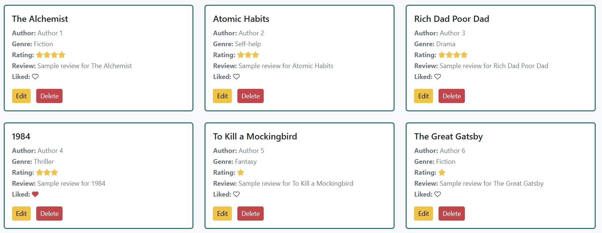

# 📚 BookLytics — Bookstore Analytics App


BookLytics is a personal reading tracker built with **ASP.NET Core MVC**. Log the books you read, rate and review them, search for new titles through the Google Books API, and see your reading habits visualized with interactive charts.

## ✨ Features

- **User accounts** — cookie-based authentication with per-user book libraries
- **Full CRUD** — add, edit, delete, and review books in your personal collection
- **Sort & filter** — sort by title, author, or rating; filter by liked/not liked
- **Google Books search** — look up new titles directly from the Google Books API
- **Analytics dashboard** — reading analytics computed server-side by a LINQ `AnalyticsService` (EF Core translates each query to SQL `GROUP BY` / `COUNT` / `AVG`), rendered with Chart.js:
  - KPI tiles: total books, average rating, % liked, genre and author counts
  - Auto-generated insights (most-read genre, highest-rated genre, how liked books rate vs. the rest)
  - Books by genre, highest-rated genres (min. 3 books), top 5 authors, rating distribution
  - Genre breakdown table (count, average rating, % liked)

## 🖼️ Screenshots

| Rate & Review | Analytics |
|---|---|
|  |  |

| Smart Search | Reading List |
|---|---|
|  |  |

## 🏗️ Tech Stack

- **ASP.NET Core MVC** (.NET 10 LTS)
- **Cookie authentication** (`Microsoft.AspNetCore.Authentication.Cookies`)
- **Entity Framework Core 10 + SQLite** — code-first `DbContext`, migrations, a `User` 1→N `Book` relationship with a foreign key, and indexes for per-user queries
- **Repository pattern + dependency injection** — controllers depend on `IBookRepository` / `IUserService`; EF-backed implementations are registered as scoped services
- **Google Books API** for external book search
- **LINQ analytics service** — `IAnalyticsService` aggregates per-user stats in the database, so the browser only receives the summarized numbers
- **Chart.js** for data visualization
- **Bootstrap 5** for layout and styling

## 📐 Data Model


## 🚀 Getting Started

### Prerequisites

- [.NET 10 SDK](https://dotnet.microsoft.com/download/dotnet/10.0)
- A [Google Books API key](https://console.cloud.google.com/apis/library/books.googleapis.com) (free tier is fine — the app works without one too, just with lower rate limits on search)

### Setup

```bash
git clone https://github.com/<your-username>/Bookstore_Analytics_App.git
cd Bookstore_Analytics_App
```

Add your Google Books API key using [.NET user secrets](https://learn.microsoft.com/en-us/aspnet/core/security/app-secrets) (recommended, keeps it out of source control):

```bash
dotnet user-secrets init
dotnet user-secrets set "GoogleBooks:ApiKey" "YOUR_API_KEY_HERE"
```

Or set it as an environment variable:

```bash
export GoogleBooks__ApiKey="YOUR_API_KEY_HERE"
```

Then run the app:

```bash
dotnet restore
dotnet run
```

The app will be available at `http://localhost:5000`.

On first run the app applies the EF Core migrations and creates `booklytics.db` (SQLite), then seeds it from `Data/Seed/*.json`. Delete `booklytics.db` to reset to the demo data.

### Working with migrations

The `dotnet-ef` CLI is pinned as a local tool:

```bash
dotnet tool restore
dotnet ef migrations add <Name> -o Data/Migrations
dotnet ef database update
```

### Demo login

The app ships with a handful of demo users in `Data/Seed/users.json` for trying it out locally (usernames: `aayushi`, `prajay`, `onisha`, `abinaya`). These are seed/demo credentials only — replace the seed files with your own data before deploying anywhere public.

## 📁 Project Structure

```
BookApp/
├── Controllers/       # MVC controllers (Books, Account, Home)
├── Models/            # Book, User, ErrorViewModel
├── Data/
│   ├── BookLyticsDbContext.cs   # EF Core DbContext + relationship/index config
│   ├── DbSeeder.cs              # Applies migrations, seeds demo data
│   ├── Migrations/              # EF Core code-first migrations
│   └── Seed/                    # books.json, users.json (demo data)
├── Services/          # EF repositories, LINQ AnalyticsService, Google Books API client
├── Views/             # Razor views
└── wwwroot/           # Static assets, CSS, JS
```

## ⚠️ Known Limitations

- SQLite is great for a single-instance demo; a multi-instance deployment would switch the EF provider to SQL Server/PostgreSQL (a one-line change in `Program.cs`).
- Passwords are hashed with unsalted SHA-256, which is not suitable for production authentication. This project prioritizes simplicity for a class assignment over production-grade security.

## 👥 Team

Built as a group project by Onisha Gangwal, Abinaya Ganesan, Prajay Khandelwal, and Aayushi Nirajkumar Desai. See the [About page](Views/Books/About.cshtml) for individual contributions.
