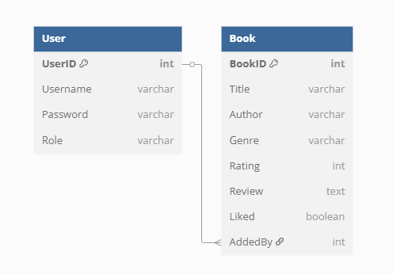

# 📚 BookLytics — Bookstore Analytics App


BookLytics is a personal reading tracker built with **ASP.NET Core MVC**. Log the books you read, rate and review them, search for new titles through the Google Books API, and see your reading habits visualized with interactive charts.

## ✨ Features

- **User accounts** — cookie-based authentication with per-user book libraries
- **Full CRUD** — add, edit, delete, and review books in your personal collection
- **Sort & filter** — sort by title, author, or rating; filter by liked/not liked
- **Google Books search** — look up new titles directly from the Google Books API
- **Analytics dashboard** — Chart.js visualizations of your library:
  - Books by genre (bar chart)
  - Top 5 authors by book count (line chart)
  - Rating distribution (pie chart)

## 🖼️ Screenshots

| Rate & Review | Analytics |
|---|---|
|  |  |

| Smart Search | Reading List |
|---|---|
|  |  |

## 🏗️ Tech Stack

- **ASP.NET Core MVC** (.NET 7)
- **Cookie authentication** (`Microsoft.AspNetCore.Authentication.Cookies`)
- **JSON file storage** — a lightweight repository pattern backed by flat JSON files, no database setup required
- **Google Books API** for external book search
- **Chart.js** for data visualization
- **Bootstrap 5** for layout and styling

## 📐 Data Model



## 🚀 Getting Started

### Prerequisites

- [.NET 7 SDK](https://dotnet.microsoft.com/download/dotnet/7.0)
- A [Google Books API key](https://console.cloud.google.com/apis/library/books.googleapis.com) (free tier is fine — the app works without one too, just with lower rate limits on search)

### Setup

```bash
git clone https://github.com/<your-username>/Bookstore_Analytics_App.git
cd Bookstore_Analytics_App
```

Add your Google Books API key using [.NET user secrets](https://learn.microsoft.com/en-us/aspnet/core/security/app-secrets) (recommended, keeps it out of source control):

```bash
dotnet user-secrets init
dotnet user-secrets set "GoogleBooks:ApiKey" "YOUR_API_KEY_HERE"
```

Or set it as an environment variable:

```bash
export GoogleBooks__ApiKey="YOUR_API_KEY_HERE"
```

Then run the app:

```bash
dotnet restore
dotnet run
```

The app will be available at `http://localhost:5000`.

### Demo login

The app ships with a handful of demo users in `users.json` for trying it out locally (usernames: `aayushi`, `prajay`, `onisha`, `abinaya`). These are seed/demo credentials only — replace `users.json` with your own data before deploying anywhere public.

## 📁 Project Structure

```
BookApp/
├── Controllers/       # MVC controllers (Books, Account, Home)
├── Models/            # Book, User, ErrorViewModel
├── Services/          # Repository + external API services
├── Views/             # Razor views
├── wwwroot/           # Static assets, CSS, JS
├── books.json         # Book data store (created at first run)
└── users.json         # Demo user accounts
```

## ⚠️ Known Limitations

- Data is stored in flat JSON files rather than a real database — fine for a demo/learning project, not for production use or concurrent writers.
- Passwords are hashed with unsalted SHA-256, which is not suitable for production authentication. This project prioritizes simplicity for a class assignment over production-grade security.

## 👥 Team

Built as a group project by Onisha Gangwal, Abinaya Ganesan, Prajay Khandelwal, and Aayushi Nirajkumar Desai. See the [About page](Views/Books/About.cshtml) for individual contributions.
